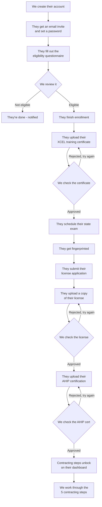

# How Agent Onboarding Works (Plain-English Version)

This is the story of what happens from the moment we hire a new agent to
the moment they're fully contracted and ready to sell.

## The journey, step by step

## What happens at each step

1. **We create the account.** They get an email with a link to set their
   password. That link works for 7 days.
2. **They fill out the eligibility questionnaire** — birthdate, home state,
   any felony convictions, citizenship/work authorization. They can only
   fill this out **once**, so it needs to be right the first time.
3. **We review it.** Every single one gets looked at by a person — there's
   no auto-approval, even if everything looks clean. We can mark someone
   Cleared, Not Eligible, or Flagged for a waiver decision. They get an
   email once we've made a final call (cleared or not eligible).
4. **Once cleared, they move through 4 quick check-off steps**, each one
   unlocked by the step before it:
   - Finish enrollment
   - Schedule their state exam *(this one actually unlocks once we've
     approved their training certificate — see next step)*
   - Get fingerprinted
   - Submit their license application
5. **They upload their XCEL training certificate.** We review it and either
   approve it or reject it with a note explaining why. If rejected, they
   can just upload a new one — no need to start over.
6. **They upload a copy of their license.** Same deal — we approve or
   reject with a note, and they can retry if rejected.
7. **They upload their AHIP certification.** Same review process again.
8. **Once AHIP is approved, contracting unlocks.** We check off 5
   contracting milestones for them (confirmed → forwarded → issued →
   carrier certs → complete) from our side — this part is entirely on us,
   the agent doesn't do anything here.

## A couple of things worth knowing

- **The training, license, and AHIP uploads aren't strictly locked to the
  order above.** Technically an agent could upload their training
  certificate or AHIP cert early, before we've even reviewed their
  eligibility. The system doesn't stop them — it just doesn't matter until
  the later steps that *do* check (like exam scheduling, which needs
  training approved first).
- **The 5 contracting checkboxes aren't locked to each other either.** We
  could mark "Complete" without having checked "Confirmed" first — the
  system trusts whoever's doing the review to check them in the right
  order.
- **Emails only go out at the big decision points**: account created,
  eligibility decided, and training/license/AHIP approved or rejected.
  The smaller steps (enrollment, exam scheduled, fingerprinting, license
  submitted, contracting) happen quietly with no email.
- Only people with onboarding-review permission can approve/reject
  anything or touch contracting — that's one single permission that
  controls all of it.
